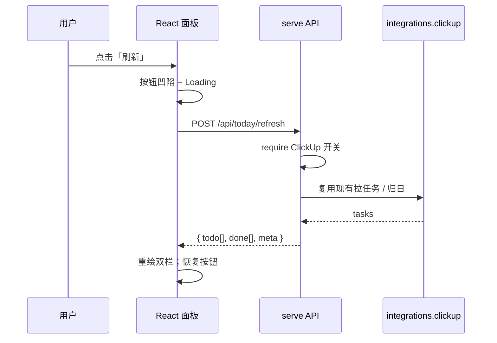

# DailyLumen · Web 看板设计草案

> **立项基线标签**：`v1.60.0`  
> **状态**：本文为**立项时**设计草案留档。执行已走 [`Web看板PRD.md`](Web看板PRD.md) → [`Web看板路线图.md`](Web看板路线图.md)；**W0–W18 ✅**（W18 已改为冷静青绿扁平，**不再**以「整站新拟物」为现行视觉）。需求 FR 仍以 [`Web看板需求文档.md`](Web看板需求文档.md) 为准。  
> **形态**（已落地）：本机前后端分离；前端 **Vite + React** build → `web/dist`（入库开箱）；后端单进程托管 dist + API；随用随启。  
> **CLI**：全部保留；Web 入口 `serve`；**业务逻辑必须复用现有 pipeline / integrations，禁止第二套 ClickUp/归日实现**。

---

## 0. 已拍板

| 项 | 定调 |
| --- | --- |
| 视觉方向 | **整站默认新拟物**；像素风以后再说（**高保真原型先不做**） |
| 前端 | **Vite + React** |
| `web/dist` | **提交一份可开箱** |
| 待办数据 | **沿用现有 `LIST_*` + clickup 归日口径** |
| 逻辑复用 | API 只编排；**不**复制 HTTP/归日代码 |
| 本阶段（立项当时） | **需求 / 功能模块**；不纠结原型观感；不启动 W1（**其后 W1–W18 已完成**，见路线图） |

---

## 1. 原型图与完成度标尺

第一版偏「线框+浅阴影」，相对成熟新拟物后台（侧栏 / 凹陷搜索 / 指标卡 / 多层卡片）差距大。  
**v2 已按该标尺抬高**，内容仍是 DailyLumen（待办/已办），不照搬财务甘特。

| 产物 | 路径 | 说明 |
| --- | --- | --- |
| **交互原型 v2** | [`docs/prototypes/web-dashboard-neu.html`](prototypes/web-dashboard-neu.html) | **请打开这个**看侧栏/搜索/指标卡/双栏/日历条/刷新 |
| 视觉稿 v2 | [`docs/prototypes/web-dashboard-neu-v2.jpg`](prototypes/web-dashboard-neu-v2.jpg) | 对齐参考完成度的氛围稿 |
| 风格参考（用户提供） | [`docs/prototypes/ref-neumorphic-dashboard.png`](prototypes/ref-neumorphic-dashboard.png) | 完成度标尺（非本产品文案） |
| 旧稿 v1 | `web-dashboard-neu-prototype.jpg` | 仅对比用 |

### 1.1 线框（首屏 · v2）

```
┌────────┬──────────────────────────────────────────────┐
│ DL     │ 今日看板          [⌕ 搜索] [mode] [头像]     │
│ 今日●  ├──────────────────────────────────────────────┤
│ 待办   │ [待办N] [已办M] [ClickUp] [收工灯]  ← 指标卡 │
│ 已办   ├─────────────────────┬────────────────────────┤
│ 复盘   │ 今日待办（凹陷槽）   │ 本周节奏 / 事件摘要     │
│ 集成   ├─────────────────────┴────────────────────────┤
│[刷新今日]│ 今日已办 + 本周负荷宽卡（示意，非真甘特）     │
└────────┴──────────────────────────────────────────────┘
```

### 1.2 刷新交互（时序）



---

## 2. 功能清单

### 2.1 P0（首期必须）

| ID | 功能 | 说明 | 复用点 |
| --- | --- | --- | --- |
| F1 | 本机 `serve` | `127.0.0.1` 启服务；托管 `web/dist`；SPA fallback | 新薄层 API |
| F2 | 健康检查 | `GET /api/health`（版本、mode、集成开关摘要） | `llm_mode` / `INTEGRATIONS` |
| F3 | 刷新今日看板 | 按钮 → 拉 ClickUp → 拆待办/已办 | **`Client` + 现有归日/`LIST_*`/`CLICKUP_LISTS`** |
| F4 | 今日待办面板 | 未完成且应出现在「今日」视野的任务（口径见下） | 与 CLI clickup 素材同源规则 |
| F5 | 今日已办面板 | 归属日 = 今天的已完成（含回拨） | `clickup-done` / pipeline 归日函数 |
| F6 | 加载 / 空 / 失败态 | 无网、开关关、401 等短句 | doctor / last_error 文案风格 |
| F7 | 底栏只读状态 | mode、ClickUp on/off、上次刷新时间 | Settings 只读 |
| F8 | 新拟物主题 | 凸起按钮、凹陷列表槽、卡片；字色高对比 | 前端 token |

**待办 / 已办口径（沿用现有，不另发明）**

- List 范围：配置里的 `LIST_DAILY` / `LIST_HABITS` / `LIST_WORK` /（可选展示）`LIST_INCUBATOR` / `LIST_ANNUAL`——与 `CLICKUP_LISTS` 元数据一致；首期默认 **daily=True 的 list**，年度/孵化是否进「今日待办」在实现前可再缩一档（建议首期：**日常+习惯+工作**，孵化/年度可折叠或次期）。
- **已办**：完成归属日 = 今天（`date_closed` + 既有「次日早上回拨」）。
- **待办**：未完成任务；展示字段至少：标题、所属 list 名、可选 due。

### 2.2 P1（紧随）

| ID | 功能 | 说明 |
| --- | --- | --- |
| F9 | 按 list 筛选 / 分段 | 面板内 tab：日常 / 习惯 / 工作 |
| F10 | 任务外链 | 打开 ClickUp 任务 URL（只跳转，Web 内不写回） |
| F11 | doctor 红绿灯只读条 | 复用收工摘要字段，不写库 |
| F12 | 记住上次刷新结果缓存 | `local/` 下短缓存，减少重复拉取（可选） |

### 2.3 P2（明确后置）

| ID | 功能 | 说明 |
| --- | --- | --- |
| F13 | Web 内改状态/评论 | 须走 `clickup-task` 同款确认语义；首期不做 |
| F14 | 复盘分数 / 饮食图 | 报告只读可视化 |
| F15 | 像素主题 | 以后再说 |
| F16 | 公网 / 鉴权 / 多用户 | 不做 |

### 2.4 非功能

| ID | 要求 |
| --- | --- |
| N1 | 密钥永不下发前端 |
| N2 | 默认只绑 localhost |
| N3 | API 层可引 FastAPI/uvicorn（optional extra）；core 仍零第三方 |
| N4 | 前后端契约用 OpenAPI 或手写 types；变更同步 |
| N5 | 单测：API mock ClickUp；前端可后补 |

---

## 3. 逻辑复用铁律（防漂移）

```
React UI  ──HTTP──►  review_tool.api（新）
                         │
                         ▼
              现有 pipeline / integrations.clickup
              （拉任务、归日、LIST_*、开关）
                         │
CLI clickup / clickup-done / clickup-task ──► 同一套函数
```

- **禁止**在 `api/` 里再写一套 ClickUp HTTP 或归日 if/else。  
- 若 Web 需要「今日待办视图」而 CLI 尚无同名函数：把编排**抽到** `pipeline` 或 `integrations` 共享模块，再让 CLI 与 API 两边调用。  
- 写回类能力（改状态）若未来做：只包现有 `clickup-task` 语义（dry-run / apply）。

---

## 4. 目录与技术（设计态，未建仓库目录）

```
web/                 # Vite + React
  src/
  dist/              # build 产出，提交入库
review_tool/
  api/               # 仅路由与 DTO；调用共享编排
```

启动心智：`python -m review_tool serve` → 浏览器开 `http://127.0.0.1:…`

---

## 5. 里程碑（确认原型后再编码）

| ID | 内容 | 状态 |
| --- | --- | --- |
| **W0** | 定调 + 原型 + 功能清单 | **进行中（本文）** |
| **W1** | serve + dist 挂载 + health | 未开工 |
| **W2** | 刷新 API + 双栏数据 | 未开工 |
| **W3** | React 新拟物面板落地 | 未开工 |
| **W4** | 态管理 + 底栏 + 错误 | 未开工 |
| **W5** | README / 开箱 dist 流程 | 未开工 |

---

## 6. 请你过目后回复

1. 首期 list 范围：是否同意默认 **日常 + 习惯 + 工作**（孵化/年度 P1）？  
2. 原型 HTML / 配图观感是否接近预期（阴影、双栏、刷新）？  
3. 功能清单 P0 是否有要加减的项？  

**确认前不写业务代码。** 你 OK 后再从 W1 开工。
