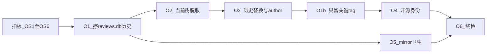

# DailyLumen · 开源前隐私擦除计划

> **用途**：在仓库改为**公开开源**之前，清掉仍可能暴露个人隐私的跟踪面与 git 历史。  
> **接续**：[`隐私与配置归一路线图.md`](隐私与配置归一路线图.md)（M45–M50 ✅，v1.52.2）→ **本文**。  
> **基线核验日**：2026-11-04（全量核验：当前树 / 全 commit / 全 tag / 仅 `main` / 新鲜浅克隆 tip）。  
> **执行收口日**：2026-11-04 —— **O1 / O1b / O2 / O3 已完成并 force push**；**O4（OS3=现账号）/ O5 / O6 已于同日收口**（可见性仍可另定，身份不换）。  
> **提交者定调（同日后续）**：全历史 author/committer 已按用户要求改回 **`63516 <635161624@qq.com>`**（仅本仓 `git config --local`；O3 曾用的开源占位身份作废）。  
> **目标**：陌生人 `git clone` 全历史后，**无法还原**你的日记、体征库、真实姓名/邮箱、同事名单、本机路径、真实补剂方案与 ClickUp/练练凭据。  
> **一次只做一个阶段**；涉及历史改写的步骤必须先 mirror，再 force push。  
> **本机运行红线（用户 2026-11-04 强调）**：`local/每日复盘/`、`local/reviews.db`、`local/.env`
> 等**本机长期运行数据必须保留、可继续 ingest/doctor**；只从 **git 跟踪面与历史 / 远端**
> 清除。⛔ 禁止删除或清空本机 `local/` 实体。  
> **双轨口径**：本机 = 完整运行时（日记 md + db + `.env`）；云端/公开 clone = 仅代码 + `local/` 空占位，**不得**含复盘正文或体征库。

---

## 0. 一页结论（先看这个）

| 维度 | 擦除后状态（2026-11-04） | 开源是否够用 |
| --- | --- | --- |
| 复盘 md / 截图（当前树 + 历史路径） | ✅ 已出 git；本机 `local/` 仍有完整日记 | ✅ 云端干净 / 本机可跑 |
| `local/.env` / API Key / list ID 真值 | ✅ 不跟踪；仅本机 | ✅ |
| **历史中的 `review_tool/reviews.db`** | ✅ O1 已擦；路径提交 = 0 | ✅ |
| git author（姓名/邮箱） | ✅ 现为 `63516 <635161624@qq.com>`（O3 曾改开源占位，后按用户要求改回） | ✅ |
| 代码/测试/文档中的真名 / 同事名 | ✅ O2/O3 化名（Owner / Teammate*） | ✅ |
| `PERSONAL_ITEMS` / 模板补剂 | ✅ 示例化（真方案只在本机） | ✅ |
| Tag 集合 | ✅ O1b：远端仅 `v1.27.0` / `v1.50.1` / `v1.52.2` | ✅ |
| GitHub 账号 `deTian0` / 是否 public | ✅ **OS3 定调：现账号，身份不换**；可见性另说 | ⏳ 转 public 前再确认可见性 |
| 本机 pre-filter mirror | ✅ O5：git mirror / 替换表已删；**保留** `local-backup-*` | ✅ 擦前 git 备份已销毁；运行时备份另存 |

**一句话**：**O1–O3 + O1b + O4（身份）+ O5 + O6 已落地**（内容面 + 历史 + tag + 本机 mirror 卫生 + 独立目录终检）。转 **public** 只剩可见性开关与 LICENSE 等运营项（见 O4 余项）。

### 0.1 这些是否足够？（直接回答）

| 问题 | 答案 |
| --- | --- |
| 只做 O1–O6 文本擦除，**够不够开源？** | **内容面够用**（再加 OS 决策）。但必须明确：**删 tag ≠ 洗掉历史提交里的隐私**。 |
| **历史提交**里的隐私？ | ✅ 计划已覆盖：O1 删路径 / O3 `replace-text` + author，作用域是 **`git rev-list --all`**（全部仍可达 commit）。 |
| **不同分支**？ | 当前本地/远端**只有 `main`**。计划要求：执行时若出现 `origin/*` 其他分支，**一律纳入** filter 与（可选）删除；禁止留未洗的 topic 分支。 |
| **全部 tag**？ | 当前 **82** 个 tag 都指向主线上的点；**每个 tag 仍是一条可达入口**。你已定调：**除关键节点外全部删除**（见 §3 OS7 / §4 O1b）。 |
| 删光非关键 tag 后，旧 commit 还在吗？ | **还在**——只要还在 `main` 祖先链上，clone 仍能走到。故 **O1/O3 不可省**；删 tag 只是减少「版本博物馆」入口与误发布面。 |

---

## 1. 已干净（无需重复劳动）

以下在 2026-11-04 核验中已通过（tip = `020c902` = `origin/main`）：

- [x] `git ls-files` 无个人 `每日复盘/`、无截图、`local/` 仅占位
- [x] `git log --all -- 每日复盘` = 0
- [x] 全历史无 `pk_…` 长 token、无 ClickUp list id 数字字面量（常见段）
- [x] 全历史无本机用户目录字面量（已改为占位 `<LOCAL_USER_DIR>`）
- [x] 新鲜浅克隆 tip：日记 0 / jpg 0 / `pk_` 0
- [x] 仅 `main` 分支；本地/远端 tag 数一致（82）；无 stash / 无 `refs/original`

---

## 2. 残留清单（开源威胁模型）

> 威胁模型：攻击者 = 任意能 clone 公开仓库的人，可遍历**全部 commit 与 tag**，可 `git cat-file` 取历史 blob。

| ID | 残留 | 敏感级别 | 暴露面 | 建议处置 |
| --- | --- | --- | --- | --- |
| **R1** | 历史 `review_tool/reviews.db`（多版本 blob 仍可达） | 🔴 高 | 全历史 | **路径删除**（filter-repo invert-paths）；保留 `reviews.example.db` |
| **R2** | git author：`DailyLumen Contributors` / QQ 邮箱 / `contributors@dailylumen.example` | 🔴 高 | 全部 commit/tag 元数据 | **mailmap 或 filter-repo 重写 author** → 通用开源身份 |
| **R3** | 测试/文档真实姓名「Owner」 | 🟡 中 | 当前树 + 历史 | 化名为 `Alex` / `Owner` 等；历史 `--replace-text` |
| **R4** | 同事名「TeammateA/TeammateB/TeammateC/TeammateD/TeammateE/TeammateF」等 | 🟡 中（他人隐私） | 当前树 + 历史 | 化名 `TeammateA` 等；历史 replace |
| **R5** | `PERSONAL_ITEMS` + `每日复盘模板.md` 真实补剂方案 | 🟡 中 | 当前树 + 历史 | 改为**虚构示例方案**；真方案只留 `local/` |
| **R6** | 文档/注释中的本机 mirror 绝对路径 | 🟢 低 | 当前树 | 改为「仓库外 mirror 目录」占位 |
| **R7** | GitHub `deTian0`、公司域邮箱 | 🟡 中 | URL / author | 🔴 开源身份策略（见 §3） |
| **R8** | M49 前 mirror 目录 | 🔴 高（库外） | 本机磁盘 | 加密归档或销毁；**永不**放进公开盘 / 网盘默认同步 |
| **R9** | 测试夹具中接近真值的体重带影子（如 `64`） | 🟢 低 | 测试 | 统一改用明显假值（如 70–75 / 175） |

**明确不在本计划「必须擦」范围（除非你另要求）**：

- 评分规则 / `FOOD_LIB` / 习惯名「墨墨背单词」等产品功能名（非身份）
- CI `tests/fixtures/corpus` 合成复盘（已是假日）
- 公开 API 默认 baseUrl（非密钥）

---

## 3. 开源前决策点（🔴 攒齐再动手）

| ID | 问题 | 选项 | 建议 |
| --- | --- | --- | --- |
| **OS1** | 是否接受再一次历史改写 + force push？ | A 接受 ／ B 只改当前树（**不够开源**） | **A** |
| **OS2** | git author 怎么处理？ | A 全历史改写成 `DailyLumen Contributors <devnull@example.com>`（或你的开源号）／ B 保留真名 | **A**（开源强烈建议） |
| **OS3** | GitHub 是否用现账号公开？ | A 现 `deTian0` 转 public ／ B **新组织/新号**推干净历史 ／ C 先 private 邀请制 | ✅ **已定：现账号 `deTian0`，身份不换**；可见性（private/public）另说，**不改**账号相关 URL 为假账号 |
| **OS4** | 补剂/护肤目录开源形态？ | A 虚构示例写入仓库 ／ B 整段迁 `local/` + example 空壳 | **A**（文档可读）或 **B**（最干净） |
| **OS5** | 同事姓名 | A 全部化名 ／ B 删除举例只留语法说明 | **A** 或 **B** 均可；禁止留真名 |
| **OS6** | LICENSE / 第三方技能正文 | 确认可开源许可；`life-decision-guide` 上游版权是否允许再分发 | 开源前单独核对 |
| **OS7** | tag 保留策略 | A 只留关键节点、其余全删 ／ B 全留 | ✅ **用户已定：只留 3 枚**（见下表） |

### 3.1 OS7 · 仅保留 3 个 tag（✅ 定稿）

| 保留 tag | 含义 |
| --- | --- |
| **v1.27.0** | 生活管家收口（M21） |
| **v1.50.1** | 深用期收口（M44） |
| **v1.52.2** | 隐私归一收口（M50）· 当前 tip 锚点 |

**删除**：其余全部（当前 **79** 个），本地 + `origin` 同步删。

### 3.2 Tag 里有没有隐私？（直接回答）

**Tag 本身几乎不存业务文件**——它只是「名字 → 某次 commit」的指针（annotated tag 还带 tagger 名/邮箱/说明）。  
隐私不在「tag 文件」里，而在它**指向的那次提交（以及该提交的全部祖先）**里。

对拟保留的三枚，**在尚未做 O1/O3 之前**实测：

| 检查 | v1.27.0 | v1.50.1 | v1.52.2 |
| --- | --- | --- | --- |
| 该 commit **树内**是否直接含 `review_tool/reviews.db` | 否（tip 树已无） | 否 | 否 |
| 该 tag 祖先链上是否仍能走到历史 `reviews.db` blob | **是（约 11 次路径提交）** | **是** | **是** |
| 该 commit **树内**是否仍有「Owner / TeammateA」等 | **有**（文档/config） | **有**（测试+文档） | **有** |
| commit / tagger 元数据是否含真实姓名邮箱 | **有**（author = `DailyLumen Contributors <…@qq.com>`） | **有** | **有** |

因此：

1. **只删掉另外 79 个 tag** → 不能去掉这三枚入口下的历史隐私。  
2. **必须先 O1（删历史 db）+ O2/O3（脱敏 + 可选改 author）**，再把这三枚 tag **打到洗净后的新 commit 上**并 force push。  
3. 开源后别人 `git checkout v1.27.0`，看到的应是**重写后**的树与作者，而不是今天这份。

（历史约束已兑现）OS1 已确认执行；O1–O3 + O1b 已 force push。OS3 / O4–O6 已于 2026-11-04 按「现账号；可见性另说」收口。

---

## 4. 阶段划分（建议编号 O1–O6）

### O1 — 补擦历史 SQLite（R1）｜P0｜高危

**作用域**：`--all`（全部分支 + 全部仍存在的 tag 所指向的历史）。当前虽只有 `main`，命令仍按全引用写，避免漏网。

**做什么**

1. 仓库外新建 mirror：`DailyLumen-pre-O1-<日期>.git`（勿放 `local/`）
2. `git filter-repo`：
   - `--invert-paths --path review_tool/reviews.db`
   - **不要**删 `review_tool/reviews.example.db`
3. 确认：`git log --all -- review_tool/reviews.db` = 0；`git rev-list --all --objects | findstr reviews.db` 仅 example（或空）
4. 用 Python 抽检：任意仍叫 `reviews.db` 的 blob 不得再存在；随机 `cat-file` 旧 SHA 应失败
5. force push **所有仍保留的分支**（至少 `main`）+ **当时仍存在的 tags**
6. 若存在非 `main` 的 `origin/*`：要么一并 force push 洗净结果，要么 **删除该远程分支**

**验收**

- [x] 全新 `git clone --mirror` 后对象库中无个人 `reviews.db` blob（`git log --all -- review_tool/reviews.db` = 0）
- [x] `reviews.example.db` 仍在；本机 `doctor` 正常
- [x] `git ls-remote` 与本地一致；仅 `main`

**明确不做**：不改业务逻辑；不碰 `local/reviews.db` 本机文件。  
**状态**：✅ **已完成**（2026-11-04）

---

### O1b — Tag 精简（OS7）｜P0｜运维（建议紧挨 O1 或 O3 之后）

**背景**：82 个 tag 都会在 GitHub UI / `git clone --tags` 暴露「完整成长史」。开源不需要保留每一次 feature tag；**关键节点足够**。

**做什么**

1. 按 §3.1 保留清单（或你当场改定的名单）生成 `KEEP_TAGS`
2. 本地：`git tag -d` 删除不在清单中的 tag
3. 远程：对每个待删 tag 执行 `git push origin :refs/tags/<name>`（批量脚本可本机一次性跑）
4. 保留的关键 tag：若刚做过 filter-repo，应对**新 commit** 重建 annotated tag 再 push（`-f`）
5. 核对：`git ls-remote --tags origin` 仅剩保留集

**验收**

- [x] 远端 tag 集合 = **仅** `v1.27.0` / `v1.50.1` / `v1.52.2` 三枚（删远程 79）
- [x] 保留 tag 已 force 到洗净后的 commit
- [x] 文档引用以关键 tag / tip 为准

**重要**：O1b **不替代** O1/O3。删 tag 只减入口；`main` 历史链上的隐私 blob/字符串仍靠 O1/O3 清除。  
**状态**：✅ **已完成**（2026-11-04）

---

### O2 — 当前树脱敏（R3/R4/R5/R6/R9）｜P0｜中

**做什么（先改树，再进 O3 洗历史）**

| 文件类 | 动作 |
| --- | --- |
| `tests/test_clickup_done.py` 等 | 「Owner」→ 开源假名；「TeammateA」→ `TeammateA` |
| `review_tool/core/clickup_done.py`、`config.py` 注释 | 删真实同事名单；举例用假名 |
| `docs/设计说明.md` / skill 中同类举例 | 同上 |
| `PERSONAL_ITEMS` + `每日复盘模板.md` | 按 OS4：示例方案（如「维生素 C / 钙片」）或空壳 + `local` 覆盖机制 |
| 隐私路线图 mirror 绝对路径 | 改为「`<repo-parent>/_mirrors/...`」占位 |
| 测试体重带 | 避免 `64` 等曾用真值；统一假值 |

**验收**

- [x] `git grep` 对擦除前真实姓名 / 私人邮箱域名在 HEAD 为 0（化名 Owner/Teammate* 允许存在）
- [x] 模板/PERSONAL_ITEMS 为通用示例；真方案只在本机
- [x] 测试 / tip 与脱敏结果一致

**状态**：✅ **已完成**（随 tip 脱敏合入）

---

### O3 — 历史文本替换 +（可选）author 重写（R2/R3/R4）｜P0｜高危

**依赖**：O2 已合入 tip，避免「洗完历史 tip 又写回真名」。  
**作用域**：全部仍存在的 refs（分支 + **保留后的**关键 tag）。建议顺序：**O1 → O2 → O3 → O1b**，或 **O1 → O1b → O2 → O3**（O3 后再强制更新所留 tag）。

**做什么**

1. 再 mirror：`DailyLumen-pre-O3-<日期>.git`
2. `git filter-repo --replace-text` 表（至少）：

   | 匹配 | 替换 |
   | --- | --- |
   | Owner | `<OWNER_ALIAS>` |
   | TeammateA / TeammateB / … | `<TEAMMATE_*>` |
   | 真实 QQ/公司邮箱 | 开源邮箱或 `contributors@dailylumen.example` |
   | 旧补剂真标签（若 O2 已改名） | 与 O2 最终示例一致 |

3. 若 OS2=A：`--name-callback` / `--email-callback`（或 filter-repo 等价）统一 author/committer
4. force push **所有分支** + **仅保留的关键 tags**（不要把已删 tag 推回去）
5. 抽检：`git branch -a`；`git ls-remote --tags`；`git log --all --format=%an%ae | sort -u`

**验收**

- [x] 历史文本替换已落地；真名/真邮不在可达 blob 中
- [x] 历史文本替换已落地；O3 当时 author = `DailyLumen Contributors <contributors@dailylumen.example>`
- [x] tip 与 O2 一致；仅 `main`
- [x] `origin/main` force push 成功（O3 时 tip=`bd6f2ef`；提交者改回后 tip 另见最新 `main`）
- [x] **2026-11-04 后续**：按用户要求全历史 author/committer/tagger 统一为 `63516 <635161624@qq.com>`（本仓 local config 同步；global 未改）

**状态**：✅ **已完成**（2026-11-04；提交者身份同日二次定调为 63516）

---

### O4 — 开源身份与仓库策略（R7）｜P1｜运维

**做什么**

- 选定 OS3：现账号 public **或** 新账号/组织推送 O3 后的干净历史
- README / LICENSE / CONTRIBUTING / SECURITY（勿贴真实联系方式）
- `gh repo view` 确认可见性；Actions secrets 不入库
- 若曾 public fork / 镜像：联系清理或视为泄露面（GitHub 缓存/fork 不保证随 force push 消失）

**验收**

- [x] **OS3 定调（2026-11-04）**：继续长期使用 `deTian0`；**身份不换**；可见性另说（尚未要求立刻转 public）
- [x] clone 来源与文档仍声明 `git@github.com:deTian0/DailyLumen.git`（未改假账号 URL）
- [ ] 转 public 前：公开页无个人邮箱明文；LICENSE / CONTRIBUTING / SECURITY 齐备（运营余项）

**状态**：✅ **身份决策已记录**；可见性开关留给你手动决定

---

### O5 — 本机与镜像卫生（R8）｜P0｜运维（可与 O1 并行规划）

**做什么**

- 列出本机：`_mirrors/DailyLumen-pre-M49-*`、`pre-O1-*`、旧 clone、网盘同步目录
- 策略二选一：**加密离线盘长期存** / **确认无回滚需求后安全删除**
- 确认 `local/` 不在任何「将公开」的同步根下

**验收**

- [x] 书面记录 mirror 清单与去留（见下）；无 mirror 路径进公开 git
- [x] 已删：擦前 **git bare mirror** / spotcheck 工作树 / 含真名映射的 replace 表
- [x] **保留（红标，禁止当 mirror 误删）**：`D:\soft_data\WorkBuddy\_mirrors\local-backup-pre-open-20261104-124742`（完整 `local/` 运行时副本：`.env` + `reviews.db` + 复盘 md）
- [x] 主仓 `local/` **未动**（103 份复盘 md + db + `.env`）

**对照**：删 `_mirrors` 里的 git mirror = 丢掉「回滚到擦前 git 历史」的备份；不删 `local/` / `local-backup-*` = 日常复盘继续跑。

**状态**：✅ **已完成**（2026-11-04；保留 local-backup）

---

### O6 — 开源发布前终检｜P0｜小

**检查单（全新临时目录执行）**

```text
git clone --mirror <公开 URL> audit.git
git clone audit.git audit-work
cd audit-work
git branch -a                                    # 仅预期分支（通常 main）
git ls-remote --tags                             # 仅 OS7 保留集
git log --all -- review_tool/reviews.db          # 须空
git log --all -- 每日复盘                        # 须空
git rev-list --all | git grep -E "pk_[A-Za-z0-9]{16,}"   # 须空（密钥）
# 另：对擦除前真实姓名/私人邮箱做一次人工或私有词表扫描，须空
git ls-files | findstr /i "jpg png .env reviews.db"  # 仅 example 许可
```

另：人工打开 README / 模板 / config，确认无用药方案指纹、无同事真名。

**验收**

- [x] 上表全绿（2026-11-04；独立目录 `D:\workspace\git\DailyLumen-open-audit-20261104`，详见该处 `AUDIT.md`）
- [x] 本文总览 / §8 已同步勾选
- [ ] 在 [`隐私与配置归一路线图.md`](隐私与配置归一路线图.md) §6 追加「开源前擦除 → 本文」指针（文档交叉引用余项，非阻断）

**状态**：✅ **检查单全绿**（2026-11-04）

---

## 5. 建议执行顺序



**排序原则**：先砍**结构化隐私库（R1）** → 再改 tip 文本 → 再洗历史文本/作者 → **精简 tag** → 最后公开与镜像处理。  
禁止在 tip 仍含真名时做 O3（会白洗）。  
**全引用纪律**：每一步 filter / 推送都以 `git branch -a` + `git ls-remote --heads --tags` 为准，禁止只洗工作区、漏远程。

---

## 6. 工具与红线

| 项 | 口径 |
| --- | --- |
| 工具 | `git filter-repo`（本机工具环境）；⛔ 不写进项目运行时依赖 |
| 备份 | 每次 filter **前**独立 mirror；保留至 O6 终检后你显式宣布可删 |
| 推送 | 仅在检查单勾完后 force push；tag 不清净则删远程 tag |
| 本机数据 | 永不删除 `local/` 实体；只动 git 历史与跟踪源码 |
| Fork 风险 | force push **不能**清掉他人已 fork 的旧历史；若仓库曾 public，按已泄露处理 |

---

## 7. 与旧决策的关系

| 旧决策 | 开源场景下的调整 |
| --- | --- |
| D4 author 推迟 | 开源前升级为 **OS2**，建议不再推迟 |
| D6=B PERSONAL_ITEMS 留代码 | 开源前改为 **OS4**：示例化或迁出 |
| D8 可见性 | 并入 **OS3** |
| M49 已授权 force push | **不能**自动延伸；O1/O3 须再口头/文字确认一次 OS1 |

---

## 8. 执行状态与下一步

| 项 | 状态 |
| --- | --- |
| **O1 / O2 / O3 / O1b** | ✅ 已完成并推远端（2026-11-04） |
| **OS7 tag** | ✅ 远端仅 **3** 枚：`v1.27.0` / `v1.50.1` / `v1.52.2` |
| **本机 `local/`** | ✅ 完整保留（103 份复盘 md + `reviews.db` + `.env`）；**不进 git / 不进云端**；本轮 **未删未改** |
| **O4 开源身份（OS3）** | ✅ **现账号 `deTian0`，身份不换**；可见性（是否转 public）另说 |
| **O5 mirror 卫生** | ✅ 已删擦前 git mirror / spotcheck / replace 表；**保留** `_mirrors/local-backup-pre-open-20261104-124742`（运行时副本，非 git） |
| **O6 终检** | ✅ 独立目录终检全绿：`D:\workspace\git\DailyLumen-open-audit-20261104\AUDIT.md` |

**下一步（非阻断）**：若要公开——手动改 GitHub 可见性；补 LICENSE/CONTRIBUTING/SECURITY；可选清理历史计划草稿里的自指扫描词。  
**双轨提醒**：日常继续在本机写复盘、`ingest`、出报告；推送只含代码。`local/**` 与 `*.env` 已被 ignore——新产生的日记也不会进远端。
---

## 9. 词表补清（2026-11-05）

按用户定调：清理全历史 / tip 中的公司域名词表与本机用户目录字面量（替换为 `<CORP_DOMAIN_EXAMPLE>` / `<LOCAL_USER_DIR>`）；**保留** `635161624@qq.com` 与 `deTian0`。