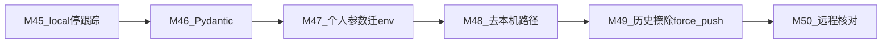

# DailyLumen · 隐私与配置归一路线图（M45–M50）

> **用途**：深用期（M36–M44）之后的下一阶段开发计划书（给 Cursor / 执行会话）。
> **一次只做一个里程碑**，做完在本文打勾、回填版本号与 commit。
> **接续**：`docs/路线图.md`（M1–M8 ✅）→ `docs/生活管家路线图.md`（M9–M21 ✅）→
> `docs/运营期路线图.md`（M22–M35 ✅）→ `docs/深用期路线图.md`（M36–M44 ✅）→ **本文**。
> **基线（本文立项时点 · 2026-11-04）**：`v1.50.1` ｜ schema **v11** ｜
> 已跟踪复盘 md **≈103** 天 + 收件箱 **≈20**（含 **5** 张截图）｜本地 tag **77** ｜
> Settings = 标准库 `dataclass`（M16）｜`pyproject.toml` `dependencies = []`。
> **阶段定位**：把「配置类个人信息 / 本机路径 / 凭据痕迹 / 复盘原文与截图」从**跟踪面与历史**
> 里清干净；未跟踪内容归一到单一父目录 **`local/`**；配置统一进 **`local/.env`** +
> **Pydantic Settings**（**打破零依赖**，D2 ✅）；**本机工作副本内容保留**，只是不再跟踪。
> **历史改写 / force push / 删不清净的 tag**：D3 ✅ 已授权，**仅在 M49 执行**（先 mirror 备份）。

---

## 0. 怎么用这份文档（给执行者 / Cursor）

1. **开工前先加载 skill**：`.workbuddy/skills/dailylumen-conventions/SKILL.md`
   （冲突时以 skill 为准；本阶段会**主动改写**其中「零依赖 / 个人参数入 git /
   复盘全文入 git」等条）。
2. **一次只做一个里程碑**，按总览表从上往下；做完打勾 + 回填版本与 commit。
3. **立项依据** = 用户 2026-11-04 目标原文 + **已拍板决策 D1–D3** + 本文附录 A 敏感面盘点。
4. 启动词见 `docs/Cursor-启动词.md`；按**本阶段下一未完成项**改写编号与任务段。
5. ⛔ **M49 之前禁止**：`git filter-repo` / `filter-branch` / BFG / force push /
   删远程 tag。M45–M48 只做当前树：gitignore / 停跟踪 / 迁路径 / 改配置栈。

---

## 1. 总览

| 里程碑 | 主题 | 一句话 | 优先级 | 大小 | 主要载体 | 目标版本 | 完成 |
| --- | --- | --- | --- | --- | --- | --- | --- |
| **M45** | `local/` + 停跟踪 | 建父目录占位；gitignore；停跟踪复盘/截图；物理迁入 + 改默认路径 | **P0** | 中 | `local/` + `.gitignore` + docs | **v1.50.2** | ✅ |
| **M46** | Pydantic Settings | 引入 `pydantic` / `pydantic-settings`；默认读 `local/.env` | **P0** | 大 | `settings.py` + `pyproject.toml` + 测试守卫翻转 | **v1.51.0** | ✅ |
| **M47** | 个人参数迁 env | `PROFILE` / `BODY_TARGETS` / list ID 等迁出；example 无真值 | **P0** | 中 | `config.py` 门面 + `local/.env` + 根 `.env.example` | **v1.52.0** | ✅ |
| **M48** | 文档/skill 去本机路径 | 绝对路径改相对或占位；启动词 / rules / skill | **P1** | 小 | docs + skills + `.cursor/rules` | **v1.52.1** | ✅ |
| **M49** | 历史擦除 + force push | filter-repo；清复盘/截图/PII；**授权后** force push；不清净则删 tag | **P0** | 大 | 运维 SOP（本机脚本可另存） | 无版本 bump（历史重写） | ✅ |
| **M50** | 远程核对与 DoD | `git ls-remote` / 抽检 blob；文档与 conventions 终态对齐 | **P0** | 小 | docs + skill | **v1.52.2** | ✅ |

**排序原则**：

> **先建 `local/` + 停跟踪（降泄露面）→ 再改配置栈（Pydantic）→ 再迁真值 → 再洗文档路径 →
> 最后改写历史（高危、D3 已授权、仍须按检查单执行）→ 远程核对收尾。**
> 不改四维评分；不删本机文件内容；**大迁移可先写进计划再动手**；M49 前不 force push。



---

## 2. 全局约束

### 2.1 沿袭（仍有效）

- **md 是源、库可 100% 重建** —— D1 ✅ 后「删库重建」改依赖 **本机 `local/每日复盘/`**
  （及私有备份 / 私有镜像）；公开 git **不再**承担日记全集。须在迁移指南写清备份通道。
- **四层架构**依赖方向不变；Settings 仍留包根。
- **schema 迁移**流程不变；本阶段**预期无 schema 变更**。
- **写盘回读校验**（Windows 间歇不落盘）照旧。
- **两套打卡体系永不合并**（R3）；新表仍不进四维（R1/R10）。

### 2.2 本阶段**主动打破**的旧硬规则（D1–D3 ✅ 定稿）

| 旧规则（M16 / conventions） | 本阶段目标（已拍板） | 须同步的落点 |
| --- | --- | --- |
| ⛔ 不引 Pydantic / python-dotenv；`dependencies = []` | 运行时依赖 **pydantic** + **pydantic-settings**（**不另引** `python-dotenv`） | `pyproject.toml`、conventions §6、`.cursor/rules`、`test_architecture` / `test_settings` 守卫**翻转**、设计说明变更日志 |
| 个人参数留 `config.PROFILE` **并随 git 走** | 个人参数进 **`local/.env`**（本机保留、不跟踪） | conventions 配置分层表、`.env.example`（根，无真值）、迁移指南 |
| git 含「全部复盘原文」以保证重建 | **D1 ✅**：复盘 md / 截图 **从当前树 + 历史**拿掉 | conventions § / CI「从 md 重建」改用 fixture 或跳过私有语料；迁移指南 |
| 历史只做方案、未授权不 force push | **D3 ✅**：授权历史改写 + force push；清不净的 tag → **删本地 + 远程 tag** | 仅 M49 执行；先 mirror |

### 2.3 单一父目录 `local/`（✅ 定稿 · 全局口径）

> **所有不进行追踪的文件，应归一到一个父文件夹。** 该父文件夹在**远程 git 的表现应是空文件夹**；
> 在**本地按实际去写**。

**实现口径（Git 不能真正存空目录）**：

| 面 | 做法 |
| --- | --- |
| **远程可见** | 只跟踪父目录下的**占位文件**：`local/.gitkeep` + 短 `local/README.md`（说明「本目录仅占位，内容 gitignore」） |
| **`.gitignore`** | `local/**` 忽略一切；`!local/.gitkeep`、`!local/README.md` 反白 |
| **本机保留** | `git rm -r --cached` 停跟踪（不删工作区）；必要时把现有敏感/本机路径**物理迁入** `local/` 下对应子树，并改代码默认路径指向 `local/...` |
| **父目录名** | 默认 **`local/`**（仓库内无更合适的既有惯例；必须**单一**父目录） |

**为何不把 `.git` 自己放进 `local/`**：

- `.git` 是仓库元数据根；挪进 `local/` 等于把「被忽略的本机内容」与「版本库本身」缠在一起，
  clone / 远程 / 工具链全部失效。
- `local/` 是**工作区旁路数据**；`.git` 是**版本控制内核** —— 二者层级不同，禁止混放。

**推荐目录树（本机实际；远程只有占位）**：

```text
local/                          # 远程：仅 .gitkeep + README.md
  .gitkeep
  README.md                     # 短说明（可跟踪）
  .env                          # 凭据 + 个人参数（推荐落点；gitignore）
  每日复盘/                     # 自仓库根迁入（复盘 md / 收件箱 / 截图 / 历史源…）
    复盘/
    收件箱/
    历史源复盘/
  reviews.db                    # 自 review_tool/reviews.db 迁入（若存在）
  exports/                      # 自根 exports/ 迁入
  backup/                       # schema / 迁移备份（原 .workbuddy/backup 可逐步归并）
  cache/                        # 可选：本机缓存；见下方「例外」与 .workbuddy
```

**明确进 `local/`**（至少）：

| 内容 | 现状 | M45+ 目标 |
| --- | --- | --- |
| `每日复盘/`（复盘 + 收件箱截图等） | 仓库根，多数已跟踪 | → `local/每日复盘/`；停跟踪 + M49 擦历史 |
| `reviews.db` | `review_tool/reviews.db`（已 ignore） | → `local/reviews.db`；改 `SETTINGS` 默认 |
| `exports/` | 根（已 ignore） | → `local/exports/` |
| 备份 / 本机缓存 | `.workbuddy/backup` 等 | → 优先 `local/backup/`；见例外 |
| **`.env`** | 根（已 ignore） | → **`local/.env`**（与「全部归一」一致）；Settings 默认读此路径；根可留一句软说明或兼容探测旧路径（过渡期） |

**例外（不迁入 `local/`，须在文档与 gitignore 写清）**：

| 路径 | 原因 | 处置 |
| --- | --- | --- |
| **`.idea/`** | IDE 固定仓库根路径，迁入不现实 | **例外**；根 `.gitignore` 忽略 `.idea/`（不入 git） |
| **`.workbuddy/*`（除 `skills/`）** | WorkBuddy 工具链约定路径；skills 须入 git | **例外保留根惯例**：已有 `.workbuddy/*` + skills 反白；记忆/缓存仍不跟踪。可选：文档鼓励缓存写 `local/cache/`，但**不强制**搬 `.workbuddy` |
| **根 `.env.example`** | 无真值模板，须随仓库走 | **留根并跟踪**；键与 `local/.env` 对齐 |
| **`每日复盘模板.md`** | 空白模板、无个人日记 | **可留根跟踪**（非敏感）；与 `local/每日复盘/` 数据分离 |
| **`review_tool/reviews.example.db`** | schema 空库模板 | **留包内跟踪** |

**过渡策略**：M45 可先落 **占位 + gitignore + 停跟踪**；物理 `Move-Item` / 改 `INPUT_DIR` /
`DB_PATH` / `export` 默认路径可在同里程碑后半或紧随的路径提交完成 —— **大迁移清单先写进本节与 M45，再动手**。

### 2.4 刻意不做 / 推迟

- ⛔ **不改四维评分 / 熔断阈值 / 历史分**。
- ⛔ **不删除用户本机工作副本**（只 untrack / gitignore / 迁路径；文件留盘）。
- ⛔ **M49 检查单未勾完前**：不对 `origin` force push、不删远程 tag（即使用户已原则授权 D3）。
- ⛔ 不打开 `FEATURES["new_day"]`、不加定时任务。
- ⛔ 不把真实密钥写进文档 / 路线图 / commit message。
- ⛔ 不在本阶段扩张采集源或改 ClickUp / 练练业务语义（仅搬配置与路径）。
- 推迟：git **作者邮箱/姓名**重写（决策点 D4，仍待定）。

---

## 3. 通用 DoD（每个里程碑）

- [ ] 全量测试通过；涉及依赖变更时 CI 矩阵能装新依赖
- [ ] `ruff` 干净
- [ ] 相关 skill / 设计说明 / README **口径同步**（本阶段尤其「零依赖」「复盘入 git」「`local/`」）
- [ ] 本文总览表打勾 + 回填版本与 commit（M49 历史重写除外）
- [ ] 写盘后回读校验
- [ ] **M49/M50**：推送后以 `git ls-remote`（及 API，若可用）核对；不信本机 `git push` 口头成功

---

## 4. 里程碑详情

### M45 — `local/` 骨架 + 敏感面停跟踪｜P0｜中｜✅ v1.50.2

**背景**：D1 ✅ —— 复盘 md / 截图要从 git（含历史）拿掉；当前树先停跟踪，历史留给 M49。
新增硬约束：未跟踪内容归一到 **`local/`**（远程仅占位）。

**已落地（v1.50.2）**：

1. **`local/` 占位**跟踪：`.gitkeep` + `README.md`
2. **`.gitignore`**：`local/**` 反白占位；根 `每日复盘/` / 旧 db / `exports/` 遗留规则；`.idea/`
3. **停跟踪**：`git rm -r --cached -- "每日复盘"`（工作区已物理迁入，不删内容）
4. **物理迁入 + 默认路径**：
   | 从 | 到 | 代码 |
   | --- | --- | --- |
   | `每日复盘/` | `local/每日复盘/` | `config.INPUT_DIR` 等 |
   | `review_tool/reviews.db` | `local/reviews.db` | `settings` 默认 `db_path` |
   | `exports/` | `local/exports/` | `config.EXPORT_DIR` |
   | 根 `.env` | `local/.env` | 默认读 `local/.env`（兼容旧根路径） |
5. CI 改用 `tests/fixtures/corpus` 合成语料；迁移指南 / conventions / intake 路径同步
6. **不引 pydantic**；**不** force push

**验收**：

- [x] `git ls-files local` = `.gitkeep` + `README.md`
- [x] `git ls-files` 无个人复盘/截图；内容在 `local/每日复盘/`
- [x] `.gitignore` 含 `local/**` 反白与 `.idea/`；根 `.env.example` 仍跟踪
- [x] 附录 A / 迁移指南与 D1 ✅ 一致

**决策引用**：D1 ✅（本里程碑执行当前树）；历史擦除 → M49

---

### M46 — 引入 Pydantic Settings｜P0｜大｜✅ v1.51.0

**背景**：D2 ✅ —— 接受引入 **pydantic**，打破「零依赖」硬规则。

**已落地（v1.51.0）**：

- `pyproject.toml` / `requirements.txt`：`pydantic>=2.0`、`pydantic-settings>=2.0`
  （不另列 `python-dotenv`）
- `review_tool/settings.py`：`BaseSettings`；默认读 `local/.env`（兼容根旧 `.env`）；
  优先级：进程环境 > env 文件 > 默认；`load_settings` API 保留
- 测试守卫翻转：`test_settings` / `test_architecture`（settings 必须 pydantic*；
  业务层禁散落；禁直接 dotenv）
- conventions / rules / 设计说明 / README / CI（`pip install -e .`）同步

**明确不做**（已遵守）：不迁 `PROFILE`（→ M47）；不 force push

**验收**：

- [x] `import pydantic` 仅出现在 settings；业务模块不散落
- [x] 全量测试绿；旧「禁 pydantic」测试已翻转
- [x] 文档不再写「⛔ 不引 Pydantic」作为**现行**规则

**决策引用**：D2 ✅；dotenv 策略 = **仅 pydantic-settings**（不另加 `python-dotenv`）

---

### M47 — `PROFILE` 等个人参数迁 env｜P0｜中｜✅ v1.52.0

**背景**：个人参数进 **`local/.env`**；代码只留读取 + 安全默认。

**已落地（v1.52.0）**：

- 真值进 `local/.env`：`PROFILE_*` / `BODY_WEIGHT_KG_*` / `CLICKUP_LIST_*`（D5=A）
- `config.py` 门面从 SETTINGS 组装；无 env → 空/None/[]（可预期）
- `.env.example` 键齐全、无真值；PERSONAL_ITEMS/HABITS 留代码（D6=B）；
  评分规则留代码（D7=B）

**明确不做**（已遵守）：历史旧 `config.py` 真值 → M49

**验收**：

- [x] 跟踪的 `config.py` 无身高/体重带/宏量/list id 真值字面量
- [x] 无 `local/.env` 时行为可预期（安全空默认）
- [x] `.env.example` 回读无真实 Key / 无真实身高体重

**决策引用**：D5=A；D6=B；D7=B

---

### M48 — 文档 / skill 去本机绝对路径｜P1｜小｜✅ v1.52.1

**背景**：（立项时）本机用户目录 / 仓库绝对路径出现在启动词、rules、skill 等现行指令段。

**已落地（v1.52.1）**：

- `.cursor/rules`、启动词、`life-steward-daily` / `doc-corpus-normalize` /
  `life-decision-guide` 现行指令改为 `$REPO` / `python` / `~/.workbuddy` / `%USERPROFILE%`
- changelog / 路线图历史叙述句保留（豁免）

**明确不做**（已遵守）：不改用户级真实安装布局；不改业务口径

**验收**：

- [x] 现行操作指令段 grep 本机用户目录 / 仓库绝对路径指纹为 0（changelog 历史句豁免）
- [x] 启动词指引：解释器来源 + 数据在 `local/`

---

### M49 — 历史擦除 + force push + tag 策略｜P0｜大｜✅（无版本 bump）

**背景**：D3 ✅ —— 用户已授权历史改写 + force push；清不净的 tag 则删本地 + 远程。

**已执行（2026-11-04）**：

- 工具：`git-filter-repo`（本机工具环境一次性安装，**非**项目运行时依赖）
- 擦除：`--invert-paths --path 每日复盘/` + `--replace-text`（身高/宏量/体重带/list id/本机路径）
- **mirror 备份**：`D:\soft_data\WorkBuddy\_mirrors\DailyLumen-pre-M49-20261104.git`
  （仓库外；不在 `local/`）
- force push：`main` + 全部 tags；`git ls-remote` 与本地 HEAD 一致
  （`ba3ecb760e511bb073b90d541ebc612fbeb71636`）
- **删除的 tags**：无（全部经 filter-repo 重写后强制更新；无需删除）
- D4 推迟（未重写 author）

**执行前检查单**：

- [x] D3 原则授权已记录（本文 ✅）
- [x] 本会话再次确认：「对 origin 执行 force push / 删 tag」（用户任务授权）
- [x] 已有裸镜像备份（路径见上）
- [x] 协作者 / 其他 clone：单人仓库，无额外通知对象
- [x] 清理路径 / 替换规则清单已定稿（附录 A + `m49-replacements.txt`）

**验收**：

- [x] 清理后 `git log --all -- 每日复盘` = 0
- [x] `git ls-remote` 与本地 main 一致
- [x] 无需删除 tag（均已重写推送）

**决策引用**：D3 ✅；D4 推迟；D1 ✅ 日记/截图进擦除列表

**恢复**：若需回滚历史，从 mirror 恢复：
`git clone D:\soft_data\WorkBuddy\_mirrors\DailyLumen-pre-M49-20261104.git`

---

### M50 — 远程核对与阶段 DoD｜P0｜小｜✅ v1.52.2

**背景**：以 `git ls-remote` / API 为准，不信本机 push 口头成功。

**已落地（v1.52.2）**：

- `git ls-remote`：`main` / `HEAD` = 本地重写后 SHA
- 临时 clone 抽检（`_mirrors/DailyLumen-M50-spotcheck`）：
  `local/` 仅 `.gitkeep` + `README.md`；无跟踪日记/截图；无密钥实体
- conventions / 启动词 / 本文总览表打勾；运行时依赖 = pydantic*；复盘不入公开 git
- D8（远端可见性）仍待本机 `gh` 确认时再拍板（不阻塞本阶段 DoD）

**验收**：

- [x] 临时 clone 抽检无附录 A「须擦除」日记/截图实体；`local/` 仅占位
- [x] M45–M50 完成态与版本号回填齐全

---

## 5. 决策点（D1–D3 ✅ 定稿；其余仍可后续拍板）

| ID | 问题 | 状态 | 定稿结论 |
| --- | --- | --- | --- |
| **D1** | 复盘 md / 收件箱截图是否移出 git（当前树 + 历史）？ | ✅ **定稿** | **要拿掉**。当前树：M45 停跟踪并迁入 `local/每日复盘/`；历史：M49 擦除。「删库重建」改依赖本机 `local/` / 私有备份 |
| **D2** | 是否接受引入 pydantic，打破零依赖？ | ✅ **定稿** | **接受**。M46 引入 `pydantic` + `pydantic-settings`；**不另引** `python-dotenv`；同步改 conventions / rules / 测试守卫 |
| **D3** | 是否授权历史改写 + force push（含 tag）？ | ✅ **定稿** | **授权**。仅在 M49 按检查单执行；清不净的 tag → **删本地 + 远程** |
| **D4** | 是否重写 git author（邮箱/姓名）？ | 🔴 待定 | 建议二期；与 GitHub 账号绑定有关 |
| **D5** | ClickUp list ID 是否迁 `.env`？ | ✅ **定稿（M47）** | **A**：进 `local/.env` |
| **D6** | `PERSONAL_ITEMS` / `HABITS` 是否迁出？ | ✅ **定稿（M47）** | **B**：留代码 |
| **D7** | 业务规则（`SCORE_*` 等）是否也进 env？ | ✅ **定稿（M47）** | **B**：规则留代码 |
| **D8** | 远端仓库可见性？ | 🔴 待定 | 请本机 `gh` 确认；public 则更依赖 M49 |

---

## 6. 建议的下一步

1. **M45–M50 ✅**（至 v1.52.2）。本阶段结束。
2. **若准备开源**：见 [`开源前隐私擦除计划.md`](开源前隐私擦除计划.md)（O1–O6）。
   核验已发现历史 `review_tool/reviews.db` 等残留，**私有去日记 ≠ 可公开 clone**。
3. 未开源时：D4（author）/ D8（可见性）仍可另开；日常复盘按 conventions + intake。
4. mirror 备份请本机自行妥善保管（勿提交进仓库、勿放公开同步盘）。

---

## 附录 A · 敏感面盘点清单（2026-11-04 只读调研；处置列随 D1–D3 更新）

> 敏感级别：🔴 高｜🟡 中｜🟢 低｜⚫ 曾待决策（D1 相关已定）。
> **建议处置**中标注 ✅ 的为已拍板方向；当前树动作随里程碑打勾（M45 ✅；历史擦除仍待 M49）。

| 路径 / 位置 | 内容类型 | 敏感级别 | 处置（拍板后） |
| --- | --- | --- | --- |
| `.env` / **`local/.env`** | 真实 API Key 等 | 🔴 | ✅ M45 已迁 **`local/.env`**；永不跟踪 |
| `.env.example`（根） | 键名模板 | 🟢 | **留根跟踪**；M47 扩键、无真值 |
| `local/` 占位 | `.gitkeep` + README | 🟢 | **跟踪**；内容实体全部 ignore |
| `review_tool/settings.py` | dataclass Settings | 🟢/冲突 | M45 默认读 `local/.env`；M46 改 Pydantic |
| `config.py` → `PROFILE` / `BODY_TARGETS` | 身高体重宏量等 | 🟡🔴 | M47 迁 env；M49 历史擦除 |
| `config.py` → `LIST_*` | list ID | 🟡 | D5；偏迁 env |
| `config.py` → `PERSONAL_ITEMS` / 姓名注释 | 健康目录 / 同事名 | 🟡 | D6；注释脱敏；历史擦除 |
| `config.py` → `SCORE_*` / `FOOD_LIB` | 业务规则 | 🟢 | 留代码（建议 D7=B） |
| `review_tool/reviews.db` → **`local/reviews.db`** | 个人库 | 🔴 | ✅ M45 已迁 `local/`；已 ignore |
| `reviews.example.db` | 空库模板 | 🟢 | 留包内跟踪 |
| `每日复盘/复盘/**` → **`local/每日复盘/`** | 日记；含体重等 | 🔴 | ✅ M45 停跟踪+迁入；历史 → M49 |
| `每日复盘/收件箱/*`（md/jpg） | 素材 + **截图** | 🔴🟡 | ✅ M45 同上；历史 → M49 |
| `exports/` → **`local/exports/`** | 导出 | 🔴 | ✅ M45 已迁 `local/` |
| `.workbuddy/*`（除 skills） | 记忆/缓存 | 🔴 | **例外**：根惯例保留 ignore；可选归并 cache→`local/cache/` |
| `.idea/` | IDE | 🟡 | **例外**：根 gitignore；不迁 `local/` |
| 启动词 / rules / skills 绝对路径 | 本机指纹 | 🟡 | M48 |
| git author / tag / 远程可见性 | 身份与历史 | 🔴🟡 | D4 / M49 / D8 |
| `dependencies = []` | 零依赖宣言 | 冲突 | **D2 ✅** → M46 更新 |

### A.1 与旧口径冲突点（摘要）

| 现状 | 已拍板目标 | 含义 |
| --- | --- | --- |
| 标准库 Settings；禁 pydantic | Pydantic Settings | M46 翻转守卫与文档 |
| `PROFILE` 入 git | 进 `local/.env` | M47 + M49 |
| git 含全部复盘原文 | D1 移出当前树 + 历史 | M45 + M49；CI 重建改 fixture |
| 未跟踪文件散落根目录 | 归一 **`local/`** | 远程仅占位 |

### A.2 凭据历史结论（调研）

- 已跟踪文件未见真实长 `pk_…` token 入库；`.env` 符合 gitignore。
- **不能**跳过 M49：`config.py` 个人参数与复盘/截图仍遍布历史。

---

## 7. 相关文档

| 想了解 | 去哪 |
| --- | --- |
| 项目口径总纲 | skill `dailylumen-conventions` |
| 上一阶段（已完成） | [`深用期路线图.md`](深用期路线图.md) |
| 能力缺口 | [`能力图谱.md`](能力图谱.md) |
| 配置分层史（M16） | `docs/生活管家路线图.md` M16；`docs/设计说明.md` v1.20.0 |
| 启动词 | [`Cursor-启动词.md`](Cursor-启动词.md) |
| 本机数据父目录说明 | `local/README.md`（占位，随仓库） |
| **开源前再擦隐私（O1–O6）** | [`开源前隐私擦除计划.md`](开源前隐私擦除计划.md) |
