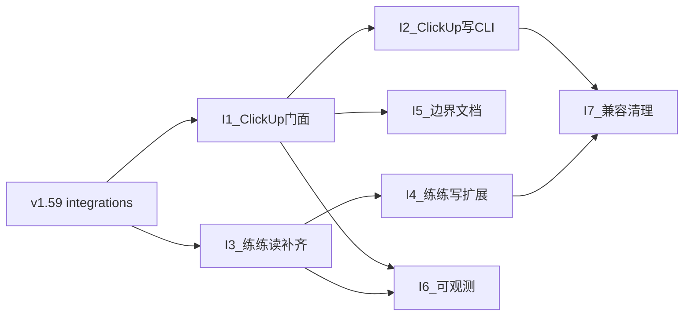

# DailyLumen · 集成能力路线图（I1–I7）

> **用途**：在 **v1.59.0** 已落地 `review_tool/integrations/`（ClickUp / 练练 / DeepSeek +
> 能力开关）之上，把「常用 API 封装」与「复盘真实需要的读写能力」做成可执行里程碑。
> **一次只做一个里程碑**，做完在本文打勾、回填版本号与 commit。
>
> **接续**：`docs/路线图.md`（M1–M8 ✅）→ 生活管家（M9–M21 ✅）→ 运营期（M22–M35 ✅）→
> 深用期（M36–M44 ✅）→ 隐私与配置归一（M45–M50 ✅）→ LLM 拆分（L-* / 至 v1.58.x）→
> **v1.59.0 集成包立基** → **本文（I1+）**。
>
> ⚠️ **勿往** 运营期 / 深用期 / 隐私归一 / 生活管家等**历史已完成路线图**追加里程碑；
> 新需求只在本文（或下一阶段新开文档）立项。
>
> **基线（本文立项时点 · 2026-11-05）**：`v1.59.0` ｜ schema **v11** ｜
> 集成层已有：`integrations/clickup|keepstrong|deepseek` + `flags.require_enabled`；
> CLI：`clickup*` / `keepstrong` / `habits --sync` / `daily-pull` 等。
> **编号**：用 **I1–I7**（Integration），与历史 **M\*** / **L-\*** 不冲突；版本号仍走
> 通用 DoD（四处对齐），不另造「I 版本」。

---

## 0. 怎么用这份文档（给执行者 / Cursor）

1. **开工前加载**：`.workbuddy\skills\dailylumen-conventions\SKILL.md` +
   `clickup-tracking` +（动练练时）`docs/练练健身-API参考.md`。
2. **一次只做一个里程碑**，按 §8 建议顺序取下一未完成项；做完打勾 + 回填版本与 commit。
3. **DoD**：测试全绿 + ruff 干净 + 文档 / skill 同步；feature = **一处版本号 + 一 commit +
   一 tag**（用户明确要求 tag 时再打）。纯文档立项可不 bump 版本。
4. 启动词可改写为：「按 `docs/集成能力路线图.md` 做 **I\<n\>**」。

---

## 1. 背景与现状

### 1.1 v1.59.0 已有什么

| 块 | 现状 | 载体 |
| --- | --- | --- |
| **分层** | 新层 `integrations/`：可被 pipeline / reports 调用；⛔ core / storage 不得依赖 | `tests/architecture` |
| **开关** | `config.INTEGRATIONS` ← Settings `INTEGRATION_*_ENABLED`（默认 True）；关则 CLI 明示、不发网 | `flags.py` / `__main__` / doctor |
| **ClickUp 门面** | `Client`：`list_tasks`（分页+去重）/ `get|create|update_task` / `set_task_status` / comments / `set_custom_field`；`http_*` + `fetch_tasks` 兼容；`load_creds` | `integrations/clickup/` |
| **ClickUp 编排** | 归日（`date_closed` + 次日补勾回拨）、素材 md、习惯 sync、受控 push「每日复盘总结」、`clickup_done` 快照 | `pipeline/clickup*` / `reports` |
| **练练门面** | 读：训练记录（**仅 completed**）、running-plans、body profile/logs、动作搜索；写：`--yes` 下设重量 / 记体征 / 排课；错误契约 401/426/429；中文 query `encode_query` | `integrations/keepstrong/` |
| **练练编排** | 只读 → 收件箱 / `--write` 落 md → `--ingest`；`daily-pull` 夜间拉齐 | `pipeline/keepstrong` |
| **DeepSeek** | 已迁 integrations；另受 `DAILYLUMEN_LLM_MODE` 门禁（**本文不以 DeepSeek 为主线**） | `integrations/deepseek/` |

### 1.2 缺口（相对「常用能力做实」）→ **v1.60.0 已收口**

| 缺口 | 说明 | 状态 |
| --- | --- | --- |
| pipeline 未全切 Client | `clickup_sync` 等直调 `http_*` | ✅ I1 改走 `Client` |
| ClickUp 高阶 / 写 CLI | 缺 `delete_task` / `get_list`；写靠 cu.bat | ✅ I1+I2（`clickup-task`；附件/webhook 仍非目标） |
| 练练读端点 | history / templates / food | ✅ I3 |
| 练练写端点 | 模板 / 计划命令；饮食 POST 不做 | ✅ I4（饮食写回仍非目标） |
| 双客户端并存 | 仓库 Client vs 本机 cu.bat | ✅ I5 文档化 |
| 观测 | 缺 last-error 摘要 | ✅ I6（`local/integration_last_error.json`） |
| Webhook / 附件 | 复盘不依赖 | **非目标**（维持） |

---

## 2. 目标与非目标

### 2.1 目标

1. **ClickUp / 练练常用能力**在 `integrations` 有稳定、可测、可注入 transport 的门面。
2. **pipeline / CLI** 只做编排（归日、渲染 md、确认写回），不散落 HTTP 细节。
3. 能力清单与个人复盘真实需要对齐（见 §5 / §6），标 P0/P1，避免「为 API 完整而完整」。
4. 开关 / 配置演进与现有 Settings 分层一致，不另开配置体系。

### 2.2 非目标（红线 · 继承）

| 红线 | 含义 |
| --- | --- |
| **凭据只 `.env` / `local/.env`** | 永不入 git / 日志 / 报告；token 不进素材 md |
| **先 md 再 ingest（G1）** | API / 截图 / LLM 都是输入通道；⛔ 只进库不落 md |
| **R1** | 同一指标一个算法来源；新报告复用既有实现 |
| **R2** | `exercise_min` 仍是健康分唯一运动输入；明细空字段才派生且标 `derived` |
| **R3** | `habit_logs` 与 `personal_tracks` **永不合并** |
| **不自动调度** | 无 cron / webhook 驱动复盘；素材手动投递（`daily-pull` 仍是人手触发） |
| **不改四维权重 / 不碰历史分** | 集成增强不进评分公式 |
| **写回外部系统** | ClickUp push / 练练 POST **仅用户明确**（`--apply` / `--yes`）；写回**不落库、不作系统状态** |
| **训练日主判据** | 练练被复盘日 `status==completed`；`training_weekdays` 仅离线兜底且须明示 |
| **DeepSeek / LLM** | 另见 `docs/LLM能力拆分草案.md`；本文不展开 |

---

## 3. 里程碑总览

| 里程碑 | 主题 | 一句话 | 优先级 | 大小 | schema | 依赖 | 完成 |
| --- | --- | --- | --- | --- | --- | --- | --- |
| **I1** | ClickUp 门面收口 | pipeline 全面走 `Client`；补 `delete_task` 等薄方法；单测加固 | **P0** | 小 | **否** | v1.59 | ✅ v1.60.0 |
| **I2** | ClickUp 复盘向写 CLI | 受控：建任务 / 改状态 / 评论（`--apply`）；不扩评分、不混习惯表 | **P0** | 中 | **否** | I1 | ✅ v1.60.0 |
| **I3** | 练练读能力补齐 | Client + 可选 CLI：`action history` / `templates`；（food 只读可选） | **P0** | 中 | **否** | v1.59 | ✅ v1.60.0 |
| **I4** | 练练写能力扩展 | 模板类 POST 等进 Client；仍 `--yes` + 回读；饮食写回默认不做 | **P1** | 中 | **否** | I3 | ✅ v1.60.0 |
| **I5** | 边界文档化 | skill / 能力图谱 / 本机 `cu.bat` vs 仓库 Client 边界；踩坑清单指针 | **P1** | 小 | **否** | I1（建议） | ✅ v1.60.0 |
| **I6** | 集成可观测 | doctor / day-help：开关 + 最近失败指引（426/401/关断）统一 | **P1** | 小 | **否** | I1+I3 建议 | ✅ v1.60.0 |
| **I7** | 兼容清理 | 去掉不必要的 pipeline re-export / 重复 HTTP 路径；架构测试加断言 | **P2** | 小 | **否** | I1–I4 | ✅ v1.60.0 |

**依赖顺序（示意）**：

**排序原则**：

> **先把门面钉死（I1）→ 再暴露复盘真正用得到的写 CLI（I2）→ 并行/随后补练练读缺口（I3）→
> 谨慎扩写（I4）→ 文档与观测（I5/I6）→ 最后清兼容债（I7）。**
> 全程预期 **不动 schema**；不引入 webhook 调度。

---

## 4. 各里程碑详述

### I1 · ClickUp 门面收口（P0 · 小 · 无 schema）

| 项 | 内容 |
| --- | --- |
| **范围** | `pipeline/clickup_sync.py`（及仍直接 `http_*` 的路径）改为 `Client.update_task` 等；补 `delete_task`（及必要时 `get_list` 只读）；保留底层 `http_*` 供测试注入；不改归日规则 |
| **涉及** | `integrations/clickup/client.py`、`pipeline/clickup*.py`、`tests/integrations/` |
| **CLI** | 行为不变；内部实现换门面 |
| **验收** | ① 架构/单测绿；② sync / pull / 素材路径无新增裸 URL 拼装；③ dry-run/`--apply` 语义不变；④ 回读校验仍在 |
| **明确不做** | 新 CLI、webhook、附件、改 list ID 口径 |

### I2 · ClickUp 复盘向写 CLI（P0 · 中 · 无 schema）

| 项 | 内容 |
| --- | --- |
| **范围** | 新增薄 CLI（建议名 `clickup-task` 或扩展既有子命令）：`--create` / `--status` / `--comment`；默认 dry-run，`--apply` 才写；写后 GET 回读；list 默认日常事务或显式 `--list` |
| **涉及** | `integrations/clickup`、`pipeline/` 或 `reports/` 薄封装、`__main__` 路由、`.env.example` 注释（若有） |
| **验收** | ① 关 `INTEGRATION_CLICKUP` 时不发网；② 不写 `habit_logs` / 不碰补剂勾选；③ 不参与四维；④ 与 `clickup-push`（只勾复盘总结）边界文档写清 |
| **明确不做** | 批量跨 list 迁移（仍归用户级 `clickup-api-bulk-tasks` / `cu.bat`）；自定义字段批量编辑（除非复盘当日硬需要） |

### I3 · 练练读能力补齐（P0 · 中 · 无 schema）

| 项 | 内容 |
| --- | --- |
| **范围** | Client 增加：`action_history`、`templates` 分页；可选 `food_logs` / `food_search`（**默认不进 daily-pull**）；中文 keyword 继续走 `encode_query`；单测 mock |
| **涉及** | `integrations/keepstrong/client.py`、可选 `pipeline/keepstrong` 子旗标、`docs/练练健身-API参考.md` 指针 |
| **验收** | ① 翻页跟 `hasMore`；② completed 过滤语义不被破坏；③ CLI 只读默认 stdout/收件箱，`--write` 才落 md；④ 仍禁止只进库 |
| **明确不做** | 改训练日算法；把练练饮食当薄荷替代权威 |

### I4 · 练练写能力扩展（P1 · 中 · 无 schema）

| 项 | 内容 |
| --- | --- |
| **范围** | 按 API 参考封装高频写：`templates` 创建/替换动作、（可选）running-plan commands；一律 `userConfirmed` + Idempotency-Key + 响应核对 |
| **涉及** | `integrations/keepstrong`、`pipeline/keepstrong` CLI 旗标、`--yes` |
| **验收** | ① 无 `--yes` 拒绝发网；② 写回不落 `reviews.db`；③ 失败不谎报成功 |
| **明确不做** | `POST food/logs`（用户饮食在薄荷，除非日后明确要求）；自动排课调度 |

### I5 · 边界文档化（P1 · 小 · 无 schema）

| 项 | 内容 |
| --- | --- |
| **范围** | 更新 `clickup-tracking`：仓库 Client vs 本机 `cu.bat`；本文 §5/§6 能力表状态回填；能力图谱「集成层」一行；独立部署「关集成」指针 |
| **验收** | 新人只读文档能分清「复盘管道命令」与「通用 ClickUp 工具」 |
| **明确不做** | 删本机工具；迁用户级 skill 进仓库 |

### I6 · 集成可观测（P1 · 小 · 无 schema）

| 项 | 内容 |
| --- | --- |
| **范围** | `doctor` / `day-help`：集成开关摘要；可选 `local/` 下无密钥的 last-error 指针（类似 `llm_last_run.json`）；426/401 指引与 KeyGuidance 对齐 |
| **验收** | 关集成时 doctor 不报「缺数据」假阳性；开集成且 Key 失效时有可执行下一步 |
| **明确不做** | 远程监控、上报遥测 |

### I7 · 兼容清理（P2 · 小 · 无 schema）

| 项 | 内容 |
| --- | --- |
| **范围** | 收敛 pipeline 对旧符号的 re-export；测试改直 import integrations；架构测试禁止 pipeline 内新写 urllib ClickUp/练练 URL（若可稳健表达） |
| **验收** | 全量测试绿；无行为变化 |
| **明确不做** | 大重构分层名；动 DeepSeek 契约 |

---

## 5. ClickUp 常用能力清单 → 里程碑

> 取舍标准：**个人复盘真实需要**（当日完成证据、习惯快照、受控勾「每日复盘总结」、偶发建任务/评论）＞ API 观光。

| 能力 | 优先级 | 现状（v1.59） | 映射 |
| --- | --- | --- | --- |
| 列表任务拉取（分页 / 含子任务 / 已完成） | **P0** | ✅ `list_tasks` / `clickup` | ✅ I1 收口 |
| 完成归日（`date_closed` + 次日补勾回拨） | **P0** | ✅ pipeline 规则 | **不改口径**；I1 未碰 |
| 习惯 → `habit_logs` | **P0** | ✅ `habits --sync` | 维持；R3 |
| 库 → 勾「每日复盘总结」 | **P0** | ✅ `clickup-push --apply` | ✅ I1 走 Client |
| 任务 GET / 改状态 | **P0** | ✅ Client + `clickup-task --status` | ✅ I2 |
| 任务创建（指定 list） | **P0** | ✅ Client + `clickup-task --create` | ✅ I2 |
| 任务评论 R/W | **P1** | ✅ Client + `clickup-task --comment` | ✅ I2 |
| 自定义字段 set/get | **P1** | ✅ Client | 复盘少用；CLI 后置 |
| 任务删除 | **P2** | ✅ `Client.delete_task` | ✅ I1；CLI 不暴露 |
| 附件上传/下载 | **P2** | ❌ | **非目标**（截图走收件箱） |
| Webhook 订阅 | **P2** | ❌ | **非目标**（破「不自动调度」） |
| 批量跨 list / 归档迁移 | **P2** | 本机工具 / 用户级 skill | **不进本仓库主线** |

---

## 6. 练练（KeepStrong）常用能力清单 → 里程碑

| 能力 | 优先级 | 现状（v1.59） | 映射 |
| --- | --- | --- | --- |
| 训练记录查询 + 翻页 | **P0** | ✅ | 维持 |
| 仅 `completed` 进训练日 / 明细 | **P0** | ✅ M20 | **不改**；I3 不得放松过滤 |
| 中文 query URL 编码 | **P0** | ✅ `encode_query` | 单测守护；I3 新接口复用 |
| `--write` 落 md → ingest | **P0** | ✅ | G1；维持 |
| 动作库搜索 + 本地 cache | **P0** | ✅ | 维持 |
| 动作 history | **P0** | ✅ `action_history` + CLI | ✅ I3 |
| 用户 templates 列表 | **P0** | ✅ `templates` + CLI | ✅ I3 |
| running-plans 只读 | **P1** | ✅ | 维持；教练旁证 |
| body profile / logs 只读 | **P1** | ✅ | 维持；体征权威仍可走截图/md |
| 写回：设重量 / 记体重 / 排课 | **P0**（已有） | ✅ 须 `--yes` | 维持 |
| 写回：模板 / 计划命令 | **P1** | ✅ `create_template` / `replace_template_actions` / `running_plan_command` | ✅ I4 |
| food 只读 | **P1** | ✅ `food_logs` / `food_search` CLI | ✅ I3 可选；非 daily-pull |
| food 写回 | **P2** | ❌ | **默认非目标**（薄荷为准） |
| 自动定时拉数 | — | ❌ | **非目标** |

---

## 7. 开关 / 配置如何演进

| 层 | 现状 | 本阶段演进 |
| --- | --- | --- |
| **凭据** | `CLICKUP_API_KEY` / `KEEPSTRONG_API_KEY` → `local/.env` | **不变**；新能力不新造密钥名 |
| **环境差异** | baseUrl / timeout / skillVersion | I3/I4 沿用 `SETTINGS.keepstrong_*`；⛔ 端点不写死业务模块 |
| **能力开关** | `INTEGRATION_CLICKUP|KEEPSTRONG|DEEPSEEK_ENABLED` | **保持三键**；I2/I4 新 CLI 必须 `require_enabled`；不擅自加「半开」第四态 |
| **个人参数** | list ID / 身高宏量等 → `local/.env` | list 真值仍只在 env；代码只引 `config.LIST_*` |
| **业务规则** | 归日 `CLICKUP_REBATE`、HABITS、训练日 completed | **留代码**；I\* 不把规则迁进 `.env` |
| **功能开关** | `FEATURES["new_day"]=False` | **不顺手打开**；集成开关 ≠ FEATURES |
| **观测文件** | `local/llm_last_run.json` 先例 | I6 若加 `local/*_last_error.json`：无密钥、gitignore |

`.env.example`：仅增加**注释说明**新 CLI 旗标（若有），不写真值。

---

## 8. 建议开工顺序（一次一个）

1. **I1**（ClickUp 门面收口）— 风险低、解锁 I2/I7，立刻减少双路径 HTTP。
2. **I3**（练练读补齐）— 可与文档阅读并行心态上「下一件」，但须 I1 合并进 main 后再开，避免双 PR 撞 integrations 惯例；若严格串行：**I1 → I3 → I2**。
3. **I2**（ClickUp 写 CLI）— 直接提升日常「记一条到 ClickUp」体验，且依赖稳定 Client。
4. **I5**（文档边界）— 可在 I2 后立刻做，纯文档+skill 也可拆小 commit。
5. **I4**（练练写扩展）— 仅当用户明确要改模板/计划时再开。
6. **I6** → **I7** 收尾。

**建议第一个开工项：I1 · ClickUp 门面收口。**

---

## 9. 与既有文档的关系

| 文档 | 关系 |
| --- | --- |
| [`能力图谱.md`](能力图谱.md) | 「现在有什么」；本文「下一步补集成」；图谱 §7 应指到本文 |
| [`练练健身-API参考.md`](练练健身-API参考.md) | 接口规格权威；I3/I4 实现对照表 |
| skill `clickup-tracking` | 归日 / 两套打卡 / list 语义；I1/I2/I5 不得改口径除非单独立项 |
| [`LLM能力拆分草案.md`](LLM能力拆分草案.md) | DeepSeek / 宿主；与本文并行、互不吞并 |
| 隐私 / 深用期 / 运营期路线图 | **历史留档，勿追加** |

---

## 变更记录（本文）

| 日期 | 说明 |
| --- | --- |
| 2026-11-05 | 立项：I1–I7；基线 v1.59.0；建议首项 I1 |
| 2026-11-05 | **I1–I7 全部完成** → **v1.60.0**（门面收口 / `clickup-task` / 练练读写扩展 / 边界文档 / `integration_last_error` / 架构 URL 守卫） |
